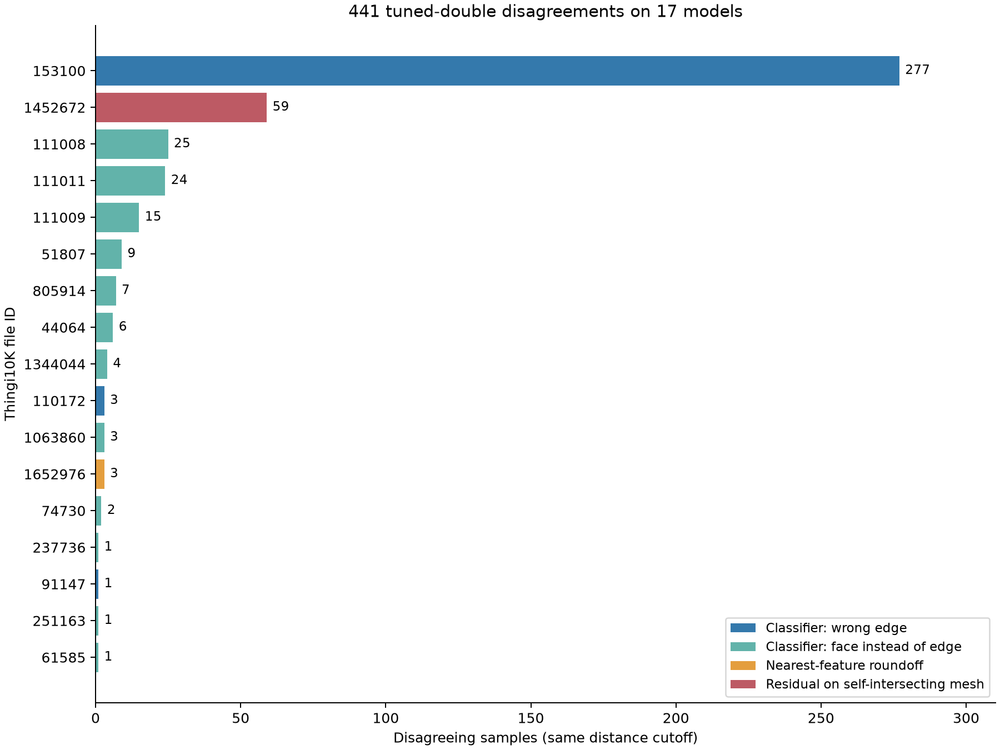

# Diagnosing all 441 tuned-double disagreements

**379 disagreements come from selecting the wrong feature normal, three from
roundoff in the nearest-feature search, and 59 persist on a mesh with exact
self-intersections. Recomputing the normals alone at higher precision fixes
none.** These are the 441 disagreements on 17 models from the full 4,963-model
validation, with double area threshold `1e-4` and epsilon `1e-9`.

| Diagnosis | Queries | Models | Evidence |
| --- | ---: | ---: | --- |
| Small-area fallback selects the wrong edge | 281 | 3 | Reusing the closest-point routine's feature with the existing normal table fixes the sign |
| Recomputed barycentrics select a face instead of an edge | 98 | 12 | The closest-point routine already returns an edge barycentric coordinate of exactly zero |
| Global nearest-feature roundoff | 3 | 1 | Exact rational mesh-wide nearest queries select a different edge and fix the sign with existing normals |
| Residual on a self-intersecting, nearly collapsed mesh | 59 | 1 | Exact nearest queries and 80/120-digit normals retain the disagreement; exact rational predicates certify strict triangle crossings |

The original sample points, mesh scale, winding signs, and distance mask are
unchanged. A disagreement is counted only where `d > 0.001 * bbd`. The original
full run sampled 49,630,000 points, of which 48,001,158 pass that distance mask.
This study diagnoses the **original failure cohort**; it does not establish
that a replacement classifier introduces no regressions elsewhere.

## All 17 models

| Thingi10K model | Disagreements | Diagnosis |
| --- | ---: | --- |
| [153100](https://ten-thousand-models.appspot.com/detail.html?file_id=153100) | 277 | Wrong edge in small-area fallback |
| [1452672](https://ten-thousand-models.appspot.com/detail.html?file_id=1452672) | 59 | Residual on self-intersecting geometry |
| [111008](https://ten-thousand-models.appspot.com/detail.html?file_id=111008) | 25 | Face instead of edge |
| [111011](https://ten-thousand-models.appspot.com/detail.html?file_id=111011) | 24 | Face instead of edge |
| [111009](https://ten-thousand-models.appspot.com/detail.html?file_id=111009) | 15 | Face instead of edge |
| [51807](https://ten-thousand-models.appspot.com/detail.html?file_id=51807) | 9 | Face instead of edge |
| [805914](https://ten-thousand-models.appspot.com/detail.html?file_id=805914) | 7 | Face instead of edge |
| [44064](https://ten-thousand-models.appspot.com/detail.html?file_id=44064) | 6 | Face instead of edge |
| [1344044](https://ten-thousand-models.appspot.com/detail.html?file_id=1344044) | 4 | Face instead of edge |
| [110172](https://ten-thousand-models.appspot.com/detail.html?file_id=110172) | 3 | Wrong edge in small-area fallback |
| [1063860](https://ten-thousand-models.appspot.com/detail.html?file_id=1063860) | 3 | Face instead of edge |
| [1652976](https://ten-thousand-models.appspot.com/detail.html?file_id=1652976) | 3 | Global nearest-feature roundoff |
| [74730](https://ten-thousand-models.appspot.com/detail.html?file_id=74730) | 2 | Face instead of edge |
| [237736](https://ten-thousand-models.appspot.com/detail.html?file_id=237736) | 1 | Face instead of edge |
| [91147](https://ten-thousand-models.appspot.com/detail.html?file_id=91147) | 1 | Wrong edge in small-area fallback |
| [251163](https://ten-thousand-models.appspot.com/detail.html?file_id=251163) | 1 | Face instead of edge |
| [61585](https://ten-thousand-models.appspot.com/detail.html?file_id=61585) | 1 | Face instead of edge |

## What fails in the classifier

The nearest-point routine computes a closest point and barycentrics describing
the feature on which it lies. `pseudonormal_test` then attempts to recover that
feature from the rounded closest point. The second calculation loses useful
information, particularly on skinny triangles.

For **153100, sample 23**, the nearest routine's barycentrics are
`[0.8375533647306668, 0, 0.16244663526933326]`, identifying edge 187. Exact rational
nearest queries agree. But the area calculation returns zero and the small-area
fallback chooses edge 189, the first qualifying edge. On this almost-collapsed
triangle, multiple edges are within epsilon of the returned closest point.

The selected edge normal is accurate to about `1.1e-16` in Euclidean norm;
it is simply the normal of the wrong edge. Its dot product with `q - c` is
`-2.82046`, whereas the correct edge's stored normal gives `+4.01524` and the
outside sign. The cached closest point and the rounded exact closest point are
identical. **All 277 double disagreements on this model are fixed by selecting
the feature already encoded by the nearest routine.** This includes the 268
double failures previously found within the invalid-float-normal cohort.

For **111008, sample 211**, nearest barycentrics are
`[0, 0.5480669228329553, 0.45193307716704473]`. Recomputing them from the closest
point gives a first coordinate of `1.178005691437889e-6`, above epsilon `1e-9`.
The classifier consequently chooses face 115 instead of edge 280. The dot
changes from `-2.19354` to `+6.78768` with the existing edge normal. The selected
face normal differs from its high-precision construction by only `3.83e-13`.

Across all 379 classifier failures, both exact local closest features and the
nearest routine's encoded features correct the signs with existing normals.
For the encoded-feature check, the original cached closest point is retained.
This points toward preserving feature identity from the nearest query rather
than trying to infer it again using another tolerance.

## The three nearest-search failures

For **1652976**, samples **2445, 4892, and 8643**, the classifier agrees with the
feature returned by the native nearest-point calculation: edge 234. Exact
rational comparisons across the mesh instead select edge 232. The squared
distances differ by only about `4e-15` to `4e-14` in original units, and the
closest points differ by roughly `1.3e-15` to `2.5e-15` times the bounding-box
diagonal. These tiny positional differences select substantially different
edge pseudonormals next to an almost-degenerate triangle.

Using the exact nearest feature fixes all three signs with the original normal
table. Higher-precision construction of the originally selected normal does
not. For sample 2445 the original dot is `-0.31055`; the correct edge gives
`+1.93428` with the stored normal.

## The 59 residual cases: model 1452672

These disagreements survive exact rational global closest-feature queries and
normals computed at both 80 and 120 decimal digits. For sample 1, both the
native and exact routines select edge 386. Its dot is `-0.725877` with the native
normal and `-0.725927` with the high-precision normal. Winding says outside in
both the fast and independently checked reference calculations.

The mesh has closed, consistently oriented combinatorial edge incidence, but
its embedding is defective. Exact rational predicates on the cached binary64
coordinates certify strict triangle-interior crossings for face pairs
**(45, 186)** and **(46, 186)**. The witnessed crossings lie about
**1.8898e-14 units from vertex 117**. This is not a contact caused by a tolerant
intersection test: the segment parameter is strictly between zero and one,
the segment endpoints have strictly opposite plane signs, and all three target
triangle barycentrics are strictly positive. The exact fractions are saved in
[audit.json](audit.json).

The dataset metadata reports `num_self_intersections = 0`. The cached binary64
realization nevertheless contains these crossings; we have not established why
the metadata differs. This audit finds strict noncoplanar crossings and is not
a complete intersection enumerator.

The pseudonormal paper assumes a closed orientable manifold surface and
discusses self-intersections and near-collapsed triangles as robustness
problems. This mesh violates the geometric assumptions, so its 59 residuals do
not demonstrate an arithmetic error in normal construction. We have not
performed a mesh-repair ablation to isolate the effect of each crossing.
See [Bærentzen and Aanæs, Sections 2 and 5](https://backend.orbit.dtu.dk/ws/portalfiles/portal/3977815/B_rentzen.pdf).

## Controls and precision checks

- Replayed all **170,000** original points on the 17 meshes. Instrumented signs
  and normal bytes exactly match the saved tuned-double baseline.
- All **441** failing queries have finite, unit-length normals. Maximum
  deviation of squared norm from one is `2.22e-16`.
- Recomputing only the final subtraction/dot at high precision fixes **zero**.
  Recomputing only the selected normal at high precision also fixes **zero**.
- High-precision normals use exact rational face cross products, then mpmath
  normalization and weighted sums. All diagnostic signs and exact feature
  identities are stable between **80 and 120 decimal digits**.
- Exact nearest features are edges in all 441 cases. Queries and mesh
  coordinates are the exact rational values of their binary64 inputs;
  outward-rounded bounding-box bounds prune the mesh search.
- Direct sums of every triangle's solid angle in extended precision and
  ordinary `igl.winding_number` confirm **all 441 reference signs**. Their
  winding values differ by at most `1.52e-14`. Extended precision on this
  machine has a 64-bit significand.
- Six focused tests cover exact skinny-triangle projections, edge/vertex
  regions, degenerate triangles, pruned versus exhaustive nearest searches,
  tetrahedron normals/winding, and strict crossings versus vertex contacts.

The main replay and diagnosis took **3.26 seconds**, excluding extension build,
the separate 120-digit rerun, and intersection audit. It used the existing
dataset cache without downloading. Per-model timings are in
[per_model.csv](per_model.csv); these are diagnostic timings, not full query
benchmark timings.

## Artifacts and next step

- [cases.json](cases.json): all 441 point IDs, coordinates, feature selections,
  barycentrics, normals, dot products, winding checks, and exact-query results.
- [diagnosis_by_model.csv](diagnosis_by_model.csv): classification counts by ID.
- [config.json](config.json): source/module hashes, dataset revision, precision,
  and cache access records.
- [summary.json](summary.json), [audit.json](audit.json): aggregate controls,
  precision-stability checks, and exact intersection witnesses.
- [PDF figure](diagnosis.pdf) and [reproduction instructions](../../README.md#diagnosing-the-17-tuned-double-failure-models).

The next implementation experiment should carry closest-feature information
into pseudonormal selection. It addresses 379 observed failures without
changing normal construction, but still needs regression testing on previously
correct points and broader validation. The three nearest-search failures need
a separate robust distance-comparison treatment. The 59 geometry residuals
require a policy for defective inputs or a different inside/outside definition.
No upstream PR implementation was changed by this diagnostic study.

Prepared by OpenAI Codex at the repository owner's request.
