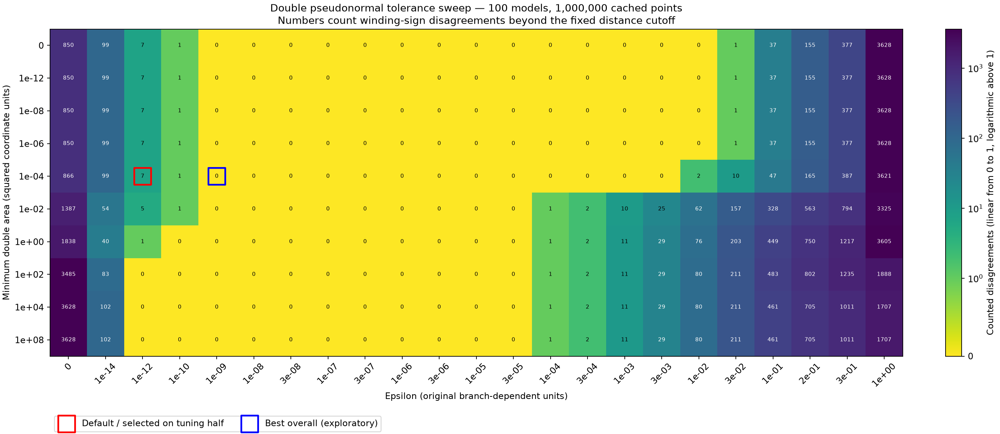

# Double pseudonormal tolerance sweep

The same 100 Thingi10K models and 1,000,000 cached points were evaluated at original scale. The saved double-input winding signs and `original_d > 0.001 * original_bbd` mask remain fixed.

A single compiled experiment exposes both tolerances as function arguments. The classifier is generated mechanically from the patched libigl source, changing only the function name and replacing its two constants with parameters. Mesh normals are computed once per model; closest faces and points come from the cached patched-float64 run. No recompilation or nearest-point search occurs between settings.

**All 1,000,000 default classifications reproduce the saved float64 baseline:** zero sign changes, zero differing normal bytes, and zero validity changes.

Swept **230 parameter pairs**: 23 epsilon values × 10 area thresholds. A model-level split (seed `20261124`) assigns 50 models to tuning and 50 to holdout before evaluation. The selected parameters minimize the tuning disagreement count; the holdout half does not select them.

| Setting | Minimum double area | Epsilon | Tuning / 500,000 | Holdout / 500,000 | All / 1,000,000 | All % | Invalid queries |
| --- | ---: | ---: | ---: | ---: | ---: | ---: | ---: |
| Default | 0.0001 | 1e-12 | 0 | 7 | 7 | 0.0007% | 0 |
| Selected on tuning half | 0.0001 | 1e-12 | 0 | 7 | 7 | 0.0007% | 0 |
| Best over all models (exploratory) | 0.0001 | 1e-09 | 0 | 0 | 0 | 0% | 0 |

The tuning-selected setting retains the defaults. All default disagreements lie in the holdout half, leaving no tuning failures to optimize. The best-overall pair uses information from the holdout and is therefore exploratory; it needs validation on additional models. The tuning-selected pair resolves 0 default disagreements and introduces 0 others. It has 7 counted disagreements with finite outputs and 0 invalid queries.

The exploratory best-overall pair resolves 7 default disagreements and introduces 0 others. It has 0 invalid queries.

[Download PDF](tolerance_grid.pdf). Complete grids: [all](grid_all.csv), [tuning](grid_tuning.csv), [holdout](grid_holdout.csv).

## Epsilon sweep at the default area threshold

| Epsilon | Disagreements | Percent of all points | Invalid queries |
| --- | ---: | ---: | ---: |
| 0 | 866 | 0.0866% | 0 |
| 1e-14 | 99 | 0.0099% | 0 |
| 1e-12 | 7 | 0.0007% | 0 |
| 1e-10 | 1 | 0.0001% | 0 |
| 1e-09 | 0 | 0% | 0 |
| 1e-08 | 0 | 0% | 0 |
| 3e-08 | 0 | 0% | 0 |
| 1e-07 | 0 | 0% | 0 |
| 3e-07 | 0 | 0% | 0 |
| 1e-06 | 0 | 0% | 0 |
| 3e-06 | 0 | 0% | 0 |
| 1e-05 | 0 | 0% | 0 |
| 3e-05 | 0 | 0% | 0 |
| 0.0001 | 0 | 0% | 0 |
| 0.0003 | 0 | 0% | 0 |
| 0.001 | 0 | 0% | 0 |
| 0.003 | 0 | 0% | 0 |
| 0.01 | 2 | 0.0002% | 0 |
| 0.03 | 10 | 0.001% | 0 |
| 0.1 | 47 | 0.0047% | 0 |
| 0.2 | 165 | 0.0165% | 0 |
| 0.3 | 387 | 0.0387% | 0 |
| 1 | 3621 | 0.3621% | 0 |

## Interpretation and timings

Epsilon is dimensionless in the barycentric branch, but measures coordinate distance in the small-area vertex/edge checks. The area threshold compares twice triangle area in squared coordinate units. These absolute tolerances were tested at original mesh scales; this does not establish scale-independent defaults. No upstream defaults or classification algorithm were changed.

Normal preprocessing: 3.924 s total. Classifier calls across all 230 settings: 23.501 s total. Sweep wall time including loading, verification and compressed output: 44.265 s. These classifier-only timings exclude nearest-point queries and are not comparable to the earlier full-query timings.

See [config.json](config.json) for exact float64 parameter values, source/module hashes and split IDs; [validation.json](validation.json) for the independent point-array recount; [per_model.csv](per_model.csv) and [selected_cases.csv](selected_cases.csv) for model/point diagnostics. All setting signs and validity flags remain cached locally by `(file_id, setting_id, sample_index)`.

Prepared by OpenAI Codex.
