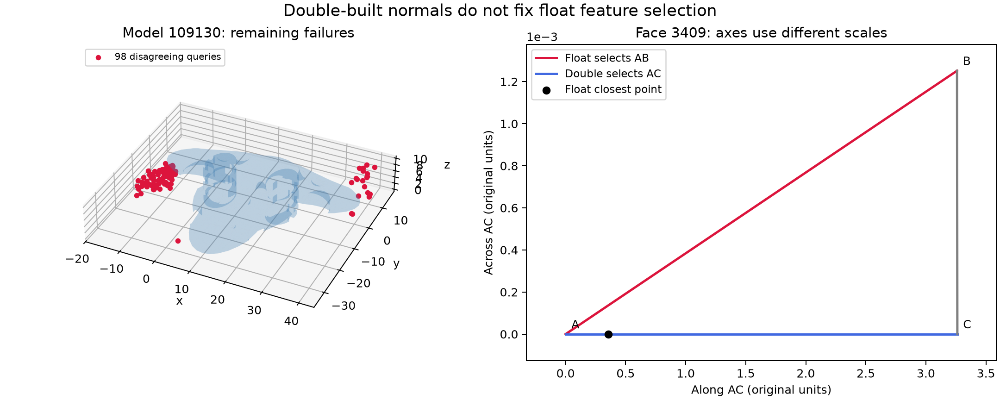

# Double-built normals used by the float classifier

Constructing **and normalizing** all normal tables in double, then casting them
to float, removes almost all nonfinite normals when using the original double
vertices. It does **not** reduce the full-set disagreement rate: 1,061 becomes
1,113. If normal construction starts with float-rounded vertices promoted to
double, the disagreement count remains 1,061 and 368 nonfinite query normals
remain.

## Controlled full-mask replay

We reused all **4,963 models × 10,000 points = 49,630,000 samples** at their
original scales. Every variant uses identical float32 mesh vertices, queries,
cached closest points, closest-face indices, and `pseudonormal_test` arithmetic.
The classifier retains the tuned float epsilon `0.003` and area threshold `1e-4`.
Only normal construction changes: unit face normals, angle-weighted vertex
normals, and uniform-weighted edge normals, including final normalization, are
constructed in the stated precision. Double tables are cast to float only after
normalization.

The reference remains the saved original double fast winding sign. The fixed
cutoff is original double distance `d > 0.001 * bbd`; 48,001,158 points satisfy
it. Percentages below divide counted disagreements by **all samples**.

| Normal construction | Disagreements | Percent of all samples | Finite-normal disagreements | Nonfinite query normals |
|---|---:|---:|---:|---:|
| Float throughout | 1,061 | 0.002137820% | 698 | 369 |
| Double on float-rounded vertices, then cast | 1,061 | 0.002137820% | 699 | 368 |
| Double on original vertices, then cast | 1,113 | 0.002242595% | 1,113 | 1 |
| Full double pipeline, saved tuned result | 441 | 0.000888575% | 441 | 0 |

Double arithmetic on rounded vertices changes only two signs: it fixes the
tiny-normal failure in model `1233195` and introduces one disagreement in
`1652975`. Original-double normal construction resolves 125 disagreements and
introduces 177, a net increase of 52 (4.9%). It resolves 368/369 nonfinite query
normals. The one remaining invalid query happens to agree with winding and is
not among the 1,113 counted disagreements. No variant returns an exactly zero
finite selected normal.

The original 100-model subset improves from **3 to 2 disagreements** with either
double-normal variant; the full mask exposes the limitations of that result.

## What remains

The original-double-normal variant has 643 edge, 377 face, and 93 vertex
disagreements. Of these, 515 take the small-area branch. Only 355 also disagree
in the saved full-double pipeline; 758 are correct there. Recomputing the final
subtraction and dot in double from the same float query, closest point, and
selected normal changes **zero signs among the counted failures**. This is
evidence to investigate feature selection and degenerate geometry next; it is
not a complete root-cause classification of all 1,113 failures.

Representative cases are exported with exact coordinates and local geometry in
[examples.json](examples.json). Sample and face indices are zero-based.

- **Wrong edge on a skinny triangle — model `109130`, sample `60`.**
  Both pipelines choose closest face `3409`; their closest points differ by only
  `2.30e-8 * bbd`. Libigl computes float barycentrics
  `[0.9375, 0.0625, 0]`, selecting edge `11266` (AB), while double gives
  approximately `[0.890953699, -1.07e-10, 0.109046301]`, selecting edge `11267`
  (AC). Double arithmetic even on the float-rounded inputs selects AC. The
  float-selected normal after double construction is
  `[0.241216794, 0.318073332, 0.916866303]`; the full-double selected normal is
  `[0.591538954, 0.780014531, -0.204105356]`. The float dot is `-0.566785812`,
  so this is not a near-zero final-dot decision. All **98 model disagreements**
  remain under both double-normal variants.
- **Triangles collapsing on conversion — model `153100`, sample `23`.**
  Face `138` has cross-product magnitude `3.12e-12` in the original coordinates;
  its float vertices are exactly collinear. Libigl's length-based `doublearea`
  evaluates to zero even in double for this face. Double normals on rounded
  vertices cannot restore the lost geometry. Original-double normals make the
  selected edge normal finite, but the sign remains wrong, with dot `-2.82046`.
  This model changes from **360 to 369 disagreements**: 92 resolved, 101
  introduced. Finite normal output does not establish a correct sign.
- **Normals sensitive to nearly degenerate original geometry — model
  `1452672`, sample `1`.** Edge `386` joins faces `46` and `187`. Face `187`
  has original cross-product magnitude `1.82e-14`; float rounding changes it
  to `5.07e-7` and reverses its dominant orientation. Rounded geometry gives
  both incident face normals `[1,0,0]`, while original geometry gives almost
  opposite normals. The resulting double-built edge normal is approximately
  `[0.0164963,-0.4145763,-0.9098650]`, with dot `-0.725873`. This model acquires
  **60 disagreements**; the saved full-double sign also disagrees at this
  example. More precise arithmetic cannot make an almost degenerate input
  well conditioned.
- **Exact cancellation still exists in double — model `57854`, sample `4939`.**
  Edge `22`, incident faces `3,4`, has exactly opposite double face normals and
  a zero sum. Its normalization is still nonfinite. The float epsilon `0.003`
  selects this edge because the relevant barycentric coordinate is about
  `0.000868`; the tuned double epsilon `1e-9` selects the face. The invalid
  float-classifier query happens to match the inside winding sign.
- **A case that is fixed — model `1233195`, sample `1521`.** Double construction
  and normalization avoid the previously diagnosed tiny-normal underflow.
  Both double-normal variants produce a finite normal and the reference sign.

The right plot uses different scales along/across the triangle to expose its
width. It is not an equal-aspect rendering. A [PDF](skinny-triangle.pdf) is also
available.

## Validation, timing, and artifacts

Every pure-float control exactly reproduces the prior tuned **normal bytes,
signs, and validity masks**. The instrumented classifier is checked against
the uninstrumented classifier for all diagnostic queries. An independent audit
recounts all point caches and verifies all 3,379 diagnostic rows; see
[audit.json](audit.json). There were no downloads or new distance/winding queries.

The replay took **519.58 seconds (8.66 minutes)** including all three variants,
cache reads, diagnostics, and writes. Summed normal setup times were 144.69 s
(float), 141.67 s (double on rounded), and 140.57 s (double on original);
classification times were 5.54 s, 5.22 s, and 5.15 s respectively. Setup includes
normal-table allocation and, for hybrids, casting and edge-map validation; the
float constructor also copies geometry. These sequential, single-pass timings
are not a controlled speed comparison or an end-to-end signed-distance timing.
Loading and writing took 33.94 s and 33.45 s respectively.

- [Configuration and provenance](config.json), [summary](summary.json),
  [per-model results](per_model.csv), [case diagnostics](cases.csv), and
  [I/O timings](timings.csv) are tracked.
- Full per-point normals, signs, and validity masks remain locally cached in
  `points/<file_id>.npz`; source meshes and baseline points are reused.
- [README reproduction instructions](../../README.md#double-built-normals-with-a-float-classifier)
  describe the native module, independent auditor, and diagnostic tools.
- Core libigl and its PR were not modified by this experiment.

Prepared by OpenAI Codex at the repository owner's request.
