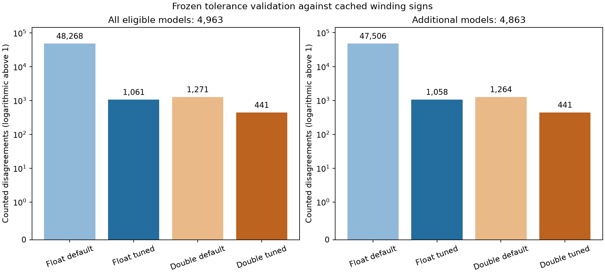

# Broader validation of frozen pseudonormal tolerances

Evaluated **4,963 models × 10,000 points = 49,630,000 points**, including 4,863 models outside the original tolerance sweeps. Parameters were fixed before this run: area threshold `1e-4` for both precisions, epsilon `0.003` for float and `1e-9` for double. The default epsilon is `1e-12`.

Meshes retain original scale, position, and topology. The reference is the previously saved double-input libigl fast winding sign. The mask is the saved original double `d > 0.001 * bbd` (48,001,158 away points). The primary percentage uses **all** sampled points. The additional models were not used in the tolerance sweeps, although their original baseline results were already available. They are broader regression validation, not a completely uninspected holdout.

## All eligible models

| Method | Disagreements | Percent of all points | Finite-output disagreements | Invalid queries | Affected models |
| --- | ---: | ---: | ---: | ---: | ---: |
| Float default | 48,268 | 0.097255692% | 48,045 | 224 | 2,160 |
| Float tuned | 1,061 | 0.0021378199% | 698 | 369 | 147 |
| Double default | 1,271 | 0.002560951% | 1,271 | 0 | 177 |
| Double tuned | 441 | 0.00088857546% | 441 | 0 | 17 |

## Models outside the original 100

| Method | Disagreements | Percent of all points | Finite-output disagreements | Invalid queries | Affected models |
| --- | ---: | ---: | ---: | ---: | ---: |
| Float default | 47,506 | 0.09768867% | 47,284 | 223 | 2,115 |
| Float tuned | 1,058 | 0.0021756118% | 696 | 368 | 144 |
| Double default | 1,264 | 0.0025992186% | 1,264 | 0 | 173 |
| Double tuned | 441 | 0.00090684762% | 441 | 0 | 17 |

## Original 100 models (reproduction)

| Method | Disagreements | Percent of all points | Finite-output disagreements | Invalid queries | Affected models |
| --- | ---: | ---: | ---: | ---: | ---: |
| Float default | 762 | 0.0762% | 761 | 1 | 45 |
| Float tuned | 3 | 0.0003% | 2 | 1 | 3 |
| Double default | 7 | 0.0007% | 7 | 0 | 4 |
| Double tuned | 0 | 0% | 0 | 0 | 0 |

## Improvements and regressions

| Precision | Resolved disagreements | Introduced disagreements | Net reduction | Invalid queries before → after |
| --- | ---: | ---: | ---: | ---: |
| Float | 47,504 | 297 | 97.8% | 224 → 369 |
| Double | 830 | 0 | 65.3% | 0 → 0 |

Float tuning introduces 145 invalid queries and resolves 0 previously invalid queries. Of its remaining invalid queries, 369 are beyond the distance cutoff.
Double tuning introduces 0 invalid queries and resolves 0 previously invalid queries. Of its remaining invalid queries, 0 are beyond the distance cutoff.

Counts use the returned sign even when the output normal is nonfinite. Finite-output disagreement and invalid-query counts are reported separately; fewer returned-sign disagreements do not by themselves establish valid classification. A disagreement with fast winding is a benchmark discrepancy, not independently proven ground truth.

[Download PDF](comparison.pdf).

## Largest remaining model counts

| Precision | File ID | Split | Default disagreements | Tuned disagreements | Introduced | Invalid tuned queries |
| --- | ---: | --- | ---: | ---: | ---: | ---: |
| Float | 153100 | additional_models | 222 | 360 | 138 | 360 |
| Float | 109130 | additional_models | 115 | 98 | 78 | 0 |
| Float | 47687 | additional_models | 143 | 77 | 40 | 0 |
| Float | 472179 | additional_models | 89 | 39 | 0 | 0 |
| Float | 42040 | additional_models | 121 | 28 | 0 | 0 |
| Float | 41360 | additional_models | 150 | 24 | 0 | 0 |
| Float | 135218 | additional_models | 59 | 22 | 0 | 0 |
| Float | 111009 | additional_models | 437 | 21 | 3 | 0 |
| Float | 74730 | additional_models | 65 | 18 | 0 | 0 |
| Float | 85770 | additional_models | 56 | 18 | 0 | 0 |
| Double | 153100 | additional_models | 277 | 277 | 0 | 0 |
| Double | 1452672 | additional_models | 59 | 59 | 0 | 0 |
| Double | 111008 | additional_models | 25 | 25 | 0 | 0 |
| Double | 111011 | additional_models | 24 | 24 | 0 | 0 |
| Double | 111009 | additional_models | 15 | 15 | 0 | 0 |
| Double | 51807 | additional_models | 9 | 9 | 0 | 0 |
| Double | 805914 | additional_models | 7 | 7 | 0 | 0 |
| Double | 44064 | additional_models | 6 | 6 | 0 | 0 |
| Double | 1344044 | additional_models | 4 | 4 | 0 | 0 |
| Double | 110172 | additional_models | 3 | 3 | 0 | 0 |

## Reproduction, timings, and retained data

The runtime default classifier reproduces all **49,630,000** baseline signs and normal bytes in each precision. Float uses a new full default signed-distance pass; double reuses its cached closest faces, points, and unsigned distances. Within each precision, default and tuned classification share the same closest geometry, so changing the tolerance does not change unsigned distances. Normals are precomputed once per runtime mesh. No recompilation occurs between parameters.

The largest float-versus-original-double unsigned-distance difference is 0.00076283779 × the bounding-box diagonal on model `472084`. These distance differences already exist in the default float query and are shared by both float sign settings.

The auditor independently recounts every point in all four variants and all three model groups, checks every per-model and aggregate integer metric, and recomputes validity from saved outputs. It also checks the original million inputs and winding masks, exact float baseline geometry/normal bytes, and both tuned sign/validity results against the original sweeps.

Validation run wall time: **1237.0 s**. New float full default queries: 814.7 s. Runtime normal preprocessing: 277.1 s. All four runtime classifier calls: 21.5 s. Compressed point output: 91.6 s. Cached double nearest-point and winding computations are excluded. This is not an end-to-end timing comparison between the two precisions. [Per-model timings](timings.csv).

[Configuration and binary/source provenance](config.json), [summary](summary.json), [independent audit](validation.json), [per-model metrics](per_model.csv), [side-by-side model comparison](model_comparison.csv), and [remaining cases](remaining_cases.csv). Remaining cases include any tuned disagreement beyond the cutoff or any invalid tuned query, with dataset file ID, point index, coordinates, raw winding, and all four signs and validity flags. All per-point arrays remain cached locally; meshes and reference points were not downloaded again.

Epsilon has dimensionless barycentric semantics in one branch and absolute coordinate-distance semantics in the small-area branch; the area threshold has squared coordinate units. These original-scale results do not establish behavior under arbitrary scaling or translation. No upstream defaults were changed.

Prepared by OpenAI Codex.
